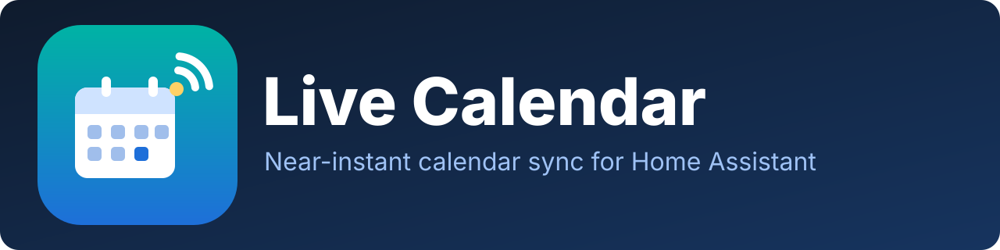

<p align="center">
  
</p>

<p align="center">
  <a href="https://github.com/hacs/integration"></a>
  <a href="https://github.com/jonathangibson98/ha-live-calendar/releases"></a>
  <a href="https://github.com/jonathangibson98/ha-live-calendar/actions/workflows/validate.yml"></a>
  <a href="LICENSE"></a>
</p>

# Live Calendar

A read-only calendar integration for [Home Assistant](https://www.home-assistant.io/), inspired by the built-in [Remote Calendar](https://www.home-assistant.io/integrations/remote_calendar) integration, but built to **pick up changes within seconds instead of once a day**.

Add an event in your calendar app and it appears in Home Assistant almost immediately, and your automations fire on it.

| | Remote Calendar (built in) | Live Calendar |
|---|---|---|
| Refresh | Every 24 h (or manual) | Every 30 s by default (min 10 s), plus instant push |
| Sources | ICS URL | ICS URL **and CalDAV** (with auto-discovery) |
| Cost when nothing changed | Full download | `304 Not Modified` / one tiny ctag request |
| Instant push | No | Yes, via a secret webhook URL |
| "Something changed" event | No | `live_calendar_changed` (added / removed / updated) |
| Cancelled events | Hidden | Hidden |

## How "real time" works (and what it can't do)

Calendar servers don't push to Home Assistant on their own, so Live Calendar combines three things:

1. **Cheap, frequent change detection.** ICS feeds are polled with `If-None-Match` / `If-Modified-Since` and a content hash, so an unchanged calendar costs one `304`. CalDAV servers are asked for their `ctag` / `sync-token` and only changed events are downloaded. The file is only parsed when something actually changed.
2. **A push webhook.** Every calendar gets a secret URL. Call it from the calendar side (a server hook, script, or automation) and Home Assistant refreshes **immediately**.
3. **A manual trigger.** The normal `homeassistant.update_entity` action refreshes on demand.

Be aware that **the calendar server decides how fresh its data is.** Some providers cache their ICS feed for hours (Google's "secret address" and Outlook.com's published links are known for this), so no integration can see changes sooner than the provider publishes them. CalDAV servers such as Nextcloud, iCloud, Fastmail and Radicale update immediately. See [docs/providers.md](docs/providers.md).

Also note that the Home Assistant calendar *panel* loads events when you open or navigate it. The calendar **entity, its state and your automations** update instantly; an already-open panel updates the next time it fetches.

## Installation

### HACS (recommended)

1. In Home Assistant open **HACS → ⋮ → Custom repositories**.
2. Add `https://github.com/jonathangibson98/ha-live-calendar` with category **Integration**.
3. Search for **Live Calendar**, download it, and **restart Home Assistant**.
4. Go to **Settings → Devices & services → Add integration → Live Calendar**.

### Manual

Copy `custom_components/live_calendar` into your Home Assistant `config/custom_components/` folder and restart.

Requires Home Assistant **2026.3.0** or newer. Full steps: [docs/installation.md](docs/installation.md).

## Setup

Choose how your calendar is available:

- **CalDAV server (fastest).** Enter the server address, username and an app password. Calendars are discovered automatically; pick one.
  Examples: `https://caldav.icloud.com`, `https://caldav.fastmail.com/dav/`, `https://cloud.example.com/remote.php/dav` (Nextcloud).
- **ICS / webcal URL.** Paste the `.ics` or `webcal://` address. Optional HTTP Basic credentials.

Add the integration once per calendar. After setup, open the integration's **Configure** dialog to change the check interval and to copy the **push URL**.

## Use it

### Instant push

Call the push URL (a `GET`, `POST` or `PUT`, no body needed) whenever your calendar changes:

```bash
curl -X POST "https://YOUR-HA/api/webhook/THE_SECRET_ID"
```

Calls closer than 2 s apart are rate-limited. Treat the URL like a password. See [docs/webhooks.md](docs/webhooks.md).

### React to changes

```yaml
automation:
  - alias: "Tell me when my calendar changes"
    triggers:
      - trigger: event
        event_type: live_calendar_changed
    actions:
      - action: notify.notify
        data:
          message: >
            {{ trigger.event.data.calendar }}:
            {{ trigger.event.data.added | map(attribute='summary') | join(', ') }} added.
```

More examples (start-of-event triggers, lights, etc.) are in [docs/automations.md](docs/automations.md).

### Entity

Each calendar becomes a `calendar.*` entity: **on** during an event, **off** otherwise, with the usual `message`, `start_time`, `end_time`, `location`, `description` and `all_day` attributes for the current or next event, plus `last_change`. It works with the Calendar panel, the `calendar.get_events` action and calendar triggers.

## Limitations

- **Read-only.** Events can't be created or edited from Home Assistant.
- **Basic authentication only.** OAuth providers (including Google CalDAV) are not supported yet.
- One calendar per config entry.
- Not yet verified against live servers. See the provider table in [docs/providers.md](docs/providers.md) and please report what works.

## Documentation

[Installation](docs/installation.md) · [Configuration](docs/configuration.md) · [Providers](docs/providers.md) · [Webhooks](docs/webhooks.md) · [Automations](docs/automations.md) · [Architecture](docs/architecture.md) · [Troubleshooting](docs/troubleshooting.md) · [Changelog](CHANGELOG.md) · [Contributing](CONTRIBUTING.md)

## Credits

Parsing uses the excellent [`ical`](https://github.com/allenporter/ical) library, the same one Home Assistant's own calendar integrations use. This is an independent community project and is not affiliated with Home Assistant or Nabu Casa.

## License

[MIT](LICENSE)
